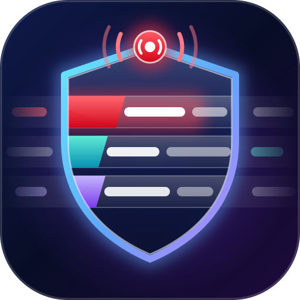
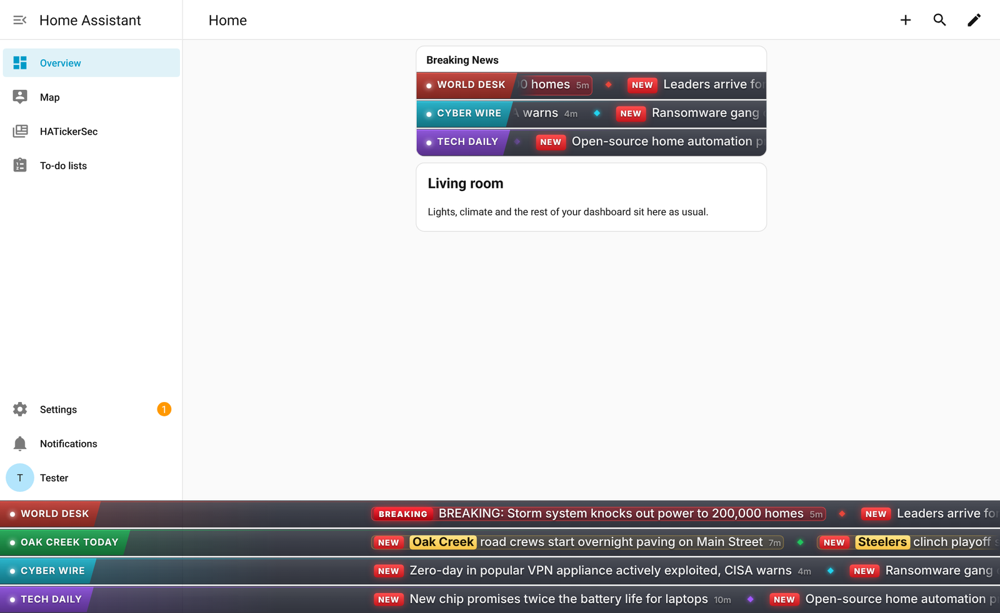
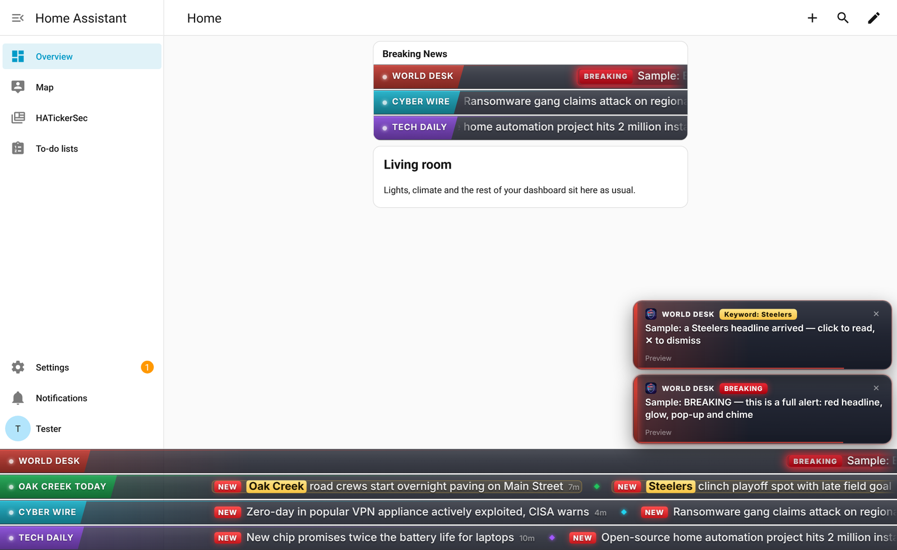
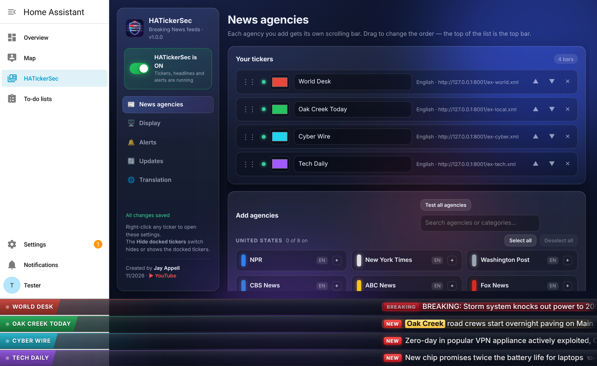
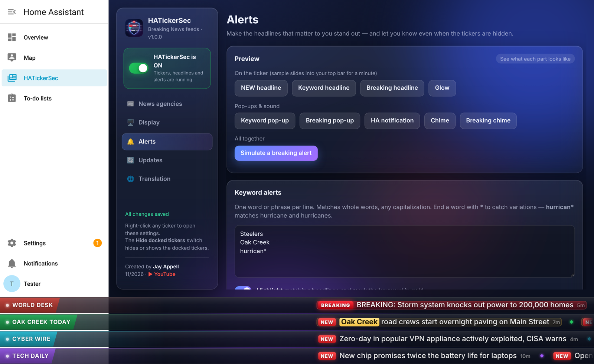
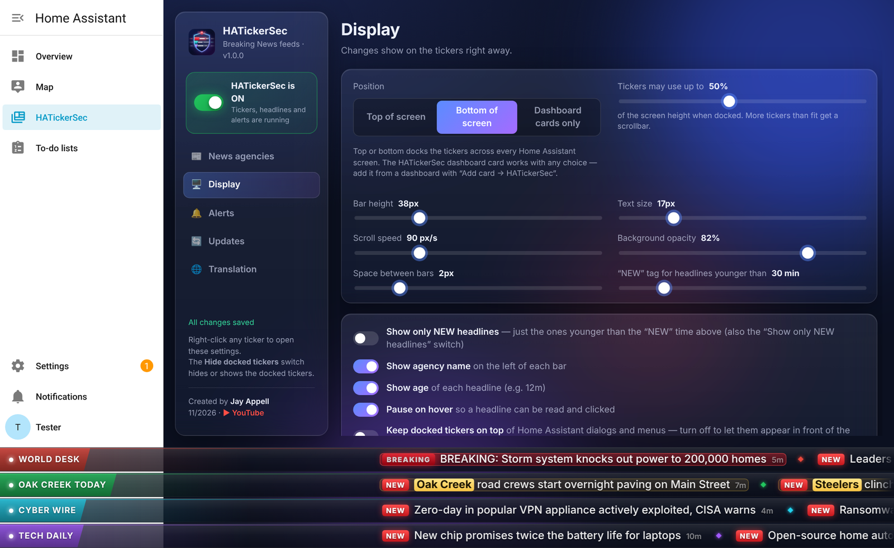
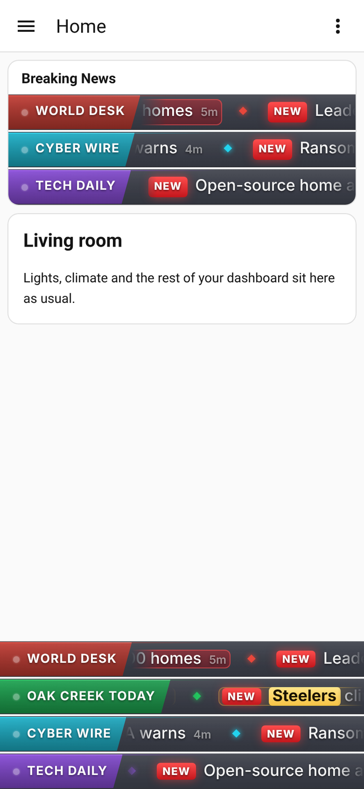

<div align="center">



# HATickerSec

**Live breaking-news headlines in glass ticker bars across Home Assistant.**

[](https://hacs.xyz/docs/faq/custom_repositories)
[](https://www.home-assistant.io/)
[](CHANGELOG.md)
[](#languages)
[](LICENSE)

</div>

Beautiful design and ease of use. https://github.com/Degederon/HATickerSec

"Is something happening right now?" HATickerSec answers that at a glance. It brings the latest headlines from the news and security sources you choose and scrolls them in sleek glass ticker bars, docked across the top or bottom of every Home Assistant screen, or in a card on any dashboard. Breaking news turns red and jumps to the front, your own keywords light up in gold, and a pop-up and chime make sure nothing important slips past, even on a wall tablet across the room.

**147 sources built in**, from world news to CISA and FBI cyber alerts, plus any RSS or Atom feed you add.

## Quick start

### Install

1. **Add the repository.** In Home Assistant, go to **Settings → Marketplace → Add via link** (on versions before 2026.11, use **HACS → ⋮ → Custom repositories**). Paste `https://github.com/Degederon/HATickerSec` and choose **Integration**.
2. **Install it.** Open **HATickerSec**, select **Install**, then restart Home Assistant.
3. **Turn it on.** Go to **Settings → Devices & services → + Add integration**, search for **HATickerSec**, pick up to four categories and where the tickers go, then select **Submit**.
4. **Refresh your browser.** Press **Ctrl + Shift + R** (Mac: **Cmd + Shift + R**). In the companion app, use **Settings → Companion app → Debugging → Reset frontend cache**.

The tickers appear straight away, docked at the bottom (or top) of every screen.

### Make a dashboard

A ready-to-go dashboard comes with HATickerSec: [`dashboards/breaking-news.yaml`](dashboards/breaking-news.yaml). It has two views:

- **News:** every ticker full screen, for a wall tablet.
- **Control:** the on/off switch and the other switches, the latest alert, and when headlines were last updated.

1. Go to **Settings → Dashboards → + Add dashboard → New dashboard from scratch**.
2. Name it `Breaking News` and select **Create**, then open it from the sidebar.
3. Select the **pencil**, then **⋮ → Raw configuration editor**.
4. Delete everything, paste the contents of [`breaking-news.yaml`](https://raw.githubusercontent.com/Degederon/HATickerSec/main/dashboards/breaking-news.yaml), then select **Save** and **Done**.

To add the tickers to an existing dashboard instead, select the **pencil**, then **+ Add card**, and search for **HATickerSec**.

### Configure

1. **Pick your sources.** Open **HATickerSec** in the sidebar. Under **News agencies**, tap any source to add it, drag to change the order, and give each bar its own name and colour.
2. **Add your keywords.** Under **Alerts**, type the words that matter to you, one per line, such as `Oak Creek`, `Steelers` or `hurrican*`.
3. **Choose how alerts reach you (optional).** Pick the glass pop-up, a Home Assistant notification, or both, and turn on a chime.
4. **Place the tickers (optional).** Under **Display**, choose **Top of screen**, **Bottom of screen** or **Dashboard cards only**, and set the bar height, text size and scroll speed.
5. **Per device (optional).** Still under **Display**, **This device** switches the docked tickers, pop-ups or chimes off for just the screen you're on.

Need more detail? See the full [step-by-step setup](#step-by-step-setup) below.

## Contents

- [Quick start](#quick-start)
- [Features](#features)
- [Take a tour](#take-a-tour)
- [Requirements](#requirements)
- [Step-by-step setup](#step-by-step-setup)
- [Dashboard configuration](#dashboard-configuration)
- [News sources](#news-sources)
- [Alerts](#alerts)
- [Updates](#updates)
- [Actions](#actions)
- [Entities and events](#entities-and-events)
- [Automation examples](#automation-examples)
- [Permissions and data](#permissions-and-data)
- [WebSocket API](#websocket-api)
- [Languages](#languages)
- [Development](#development)
- [Troubleshooting](#troubleshooting)
- [Contributing](#contributing)
- [License](#license)

## Features

| Feature | Description |
|---|---|
| **Glass ticker bars** | One smooth, seamless bar per source, with its name, a **NEW** tag and the age of every headline. Click a headline to open the story; hover to pause it. |
| **Docked on every screen** | The tickers sit along the top or bottom of every Home Assistant page, and Home Assistant makes room for them, so they never cover a button or menu. |
| **A card for any dashboard** | Add the tickers to a dashboard, with a title, a maximum height, or just the sources and categories you pick. |
| **147 sources built in** | U.S., U.K., Europe, Asia and Africa, Cybersecurity, Government Cyber Alerts (CISA, CISA KEV, FBI and IC3, NCSC, Canada, Australia), Technology, Science and Space, Health, Business, Sports, Weather and Disasters, and Gaming. |
| **Consolidated tickers** | **Cyber Breaking News** and **Breaking Across the U.S.** each watch dozens of sources and show only real incidents, newest first, in one bar. |
| **Categories** | Topic groups get a title strip and a bar per source. Tap the strip to combine them into one bar, and tap again to split them. |
| **Breaking news stands out** | Headlines that start with BREAKING, LIVE, URGENT, JUST IN and more turn red, get a **BREAKING** tag and jump to the front. |
| **Your keywords in gold** | Whole words, any capitalization. End a word with `*` to catch variations: `hurrican*` matches hurricane and hurricanes. |
| **Pop-ups and chimes** | A glass pop-up slides in on every open screen. Five chime sounds, each with a calmer and a more urgent version, with volume and quiet hours. |
| **Home Assistant notifications** | Alerts can also land in Home Assistant's notification list and on your phone, or go to any notify service. |
| **Translation** | Headlines from sources in other languages are translated (Google, MyMemory, LibreTranslate or DeepL). Hover to see the original. |
| **Custom feeds** | Paste any RSS or Atom address. **Test feed** checks it first, and **Test all agencies** outlines every source green or red. |
| **Preview everything** | Try a NEW, keyword or breaking headline, a glow, a pop-up, a chime or a full breaking alert before it happens for real. |
| **One-click updates** | **Check for updates** in the panel installs the newest GitHub release, no setup needed. The Marketplace and HACS offer it too. |
| **Automation support** | An on/off switch, sensors for the latest alert and headline count, and an event for every new alert headline. |

## Take a tour

All pictures are from HATickerSec itself, with example headlines.

<table>
<tr>
<td width="50%" valign="top"><br><sub>Tickers docked at the bottom of every screen, and a HATickerSec card on a dashboard.</sub></td>
<td width="50%" valign="top"><br><sub>A breaking headline turns red and jumps to the front; pop-ups slide in.</sub></td>
</tr>
<tr>
<td width="50%" valign="top"><br><sub>Pick your sources in the HATickerSec panel, drag to reorder, and give each bar a name and colour.</sub></td>
<td width="50%" valign="top"><br><sub>Preview every alert, and set your keywords and breaking words.</sub></td>
</tr>
<tr>
<td width="50%" valign="top"><br><sub>Place the tickers and set their size, speed and look.</sub></td>
<td width="50%" valign="top" align="center"><br><sub>On a phone.</sub></td>
</tr>
</table>

### Architecture

A single installation provides three parts:

- **Integration** (`hatickersec`): fetches the feeds, finds breaking and keyword headlines, translates, and provides the switches, sensors, events, notifications and updates.
- **Tickers and card** (`custom:hatickersec-card`): the glass bars, docked on every page and as a dashboard card, served by the integration and loaded on every page automatically.
- **Panel** (**HATickerSec** in the sidebar): every setting, for administrators.

## Requirements

- Home Assistant **2024.8** or later. On **2026.11** and later, install through the built-in **Marketplace**; on earlier versions, use **HACS**. The HATickerSec icon shows in Home Assistant's lists from **2026.3**.
- A GitHub account, to add the repository to the Marketplace or HACS.
- Internet access from Home Assistant, to fetch the feeds.

## Step-by-step setup

Follow these parts in order. Each one only needs to be done once.

### Part 1: Install the integration

**Using the Marketplace (Home Assistant 2026.11 and later)**

1. Go to **Settings → Marketplace**.
2. The first time, read the community-content warning and confirm.
3. Choose **Add via link**, paste `https://github.com/Degederon/HATickerSec`, and choose **Integration** if asked. You may be asked to connect your GitHub account.
4. Open **HATickerSec** and select **Install**.
5. Restart Home Assistant: **Settings → System**, select the power icon (top right), then **Restart Home Assistant**.

**Using HACS (earlier versions)**

1. In HACS, open the menu (⋮) and select **Custom repositories**.
2. Paste `https://github.com/Degederon/HATickerSec`, choose the category **Integration**, and select **Add**.
3. Search for **HATickerSec** and install it.
4. Restart Home Assistant.

**Manual installation**

1. Download the latest release.
2. Copy `custom_components/hatickersec` into your `config/custom_components/` folder.
3. Restart Home Assistant.

### Part 2: Turn on the integration

Downloading the integration is not enough; it also has to be added.

1. Go to **Settings → Devices & services**.
2. Select **+ Add integration** (bottom right).
3. Search for **HATickerSec** and select it.
4. **What would you like to follow?** Pick up to four categories, such as **U.S. News**, **World News**, **Cyber Breaking News** or **Weather & Disasters**. Each one comes with its trusted sources.
5. **Where should the tickers go?** Choose **Bottom of the screen**, **Top of the screen**, or **Only in dashboard cards I add**.
6. Select **Submit**.

To confirm it's working, open **HATickerSec** on the **Devices & services** page. You should see a device with a **HATickerSec** switch that's on, and **HATickerSec** appears in the sidebar.

### Part 3: Load the display file

This happens automatically: the integration loads the tickers on every Home Assistant page. You don't need to add a dashboard resource.

After installing or updating, refresh the page once so your browser loads the new version:

- **Computer:** press **Ctrl + Shift + R** (Mac: **Cmd + Shift + R**).
- **Companion app:** go to **Settings → Companion app → Debugging → Reset frontend cache**, then reopen the app.

> [!TIP]
> To check that the file is reachable, open your Home Assistant address followed by `/hatickersec_static/hatickersec.js`, for example `http://homeassistant.local:8123/hatickersec_static/hatickersec.js`. You should see a page of code.

### Part 4: Choose your sources

1. Open **HATickerSec** in the sidebar.
2. Under **News agencies**, the sources in **Your tickers** are the bars on screen, top to bottom.
3. Below, under **Add agencies**, tap a source to add it, or **Select all** to add a whole group. Use the search box to find one.
4. In **Your tickers**, drag a source (or use **▲** and **▼**) to change the order. Change the name shown on its bar, or pick a new colour.
5. To add your own source, go to **Add a custom feed**, paste its RSS or Atom address, select **Test feed**, then **Add feed**.

Changes are saved and shown on every screen straight away.

### Part 5: Set up alerts

1. Open **Alerts** in the HATickerSec panel.
2. Under **Keyword alerts**, type one word or phrase per line. Matching headlines are marked in gold.
3. Under **Breaking news**, keep **Detect breaking headlines** on, and choose whether breaking headlines get a pop-up too.
4. Under **How alerts pop up**, choose **HATickerSec pop-up**, **Home Assistant notification**, or **Both**. To send them to a phone too, enter its notify service, for example `notify.mobile_app_my_phone`.
5. Under **Glow & sound**, turn on **Play a chime**, pick a sound, and set **Quiet hours**.
6. Select **Simulate a breaking alert** at the top to see it all together.

### Part 6: Place the tickers

1. Open **Display** in the HATickerSec panel.
2. Under **Position**, choose **Top of screen**, **Bottom of screen**, or **Dashboard cards only**.
3. Set **Tickers may use up to** a share of the screen. When there are more tickers than fit, they get a scrollbar.
4. Adjust the bar height, text size, scroll speed, background opacity and the age for the **NEW** tag.
5. Under **This device**, switch off the docked tickers, pop-ups or chimes for just the device you're on, such as your phone.

### What happens automatically

- **Refreshing:** every source is checked every 5 minutes (change it under **Updates**). A source that can't be reached keeps its last headlines and shows why.
- **New alerts:** a headline alerts once. Old headlines don't alert on start-up, and a headline that's already been seen never alerts again.
- **Many alerts at once:** more than four at once become one pop-up that sums them up, so the screen doesn't fill up.
- **Updates:** HATickerSec checks GitHub for a new release every few hours and shows a pop-up once per new version.

## Dashboard configuration

For wall tablets, add the card to a **Panel** view (or a full-width **Sections** view). The card can be configured in the visual editor or in YAML:

```yaml
type: custom:hatickersec-card
title: Breaking News
max_height: 300
include:
  - Cyber Breaking News
  - bbc
```

| Option | Type | Default | Description |
|---|---|---|---|
| `title` | string | — | Title shown above the bars. Leave empty to hide it. |
| `max_height` | number | Every bar | Maximum height in pixels. More bars than fit get a scrollbar. |
| `include` | list | Every source | Only show these sources (by id) or categories (by name), for example `Cybersecurity` or `npr`. |

Everything else (bar height, text size, speed, colours, labels) is set once in the HATickerSec panel and applies to every card and the docked tickers.

> [!TIP]
> For a dedicated wall display, set **Position** to **Dashboard cards only** and run the dashboard in kiosk mode, for example with Fully Kiosk Browser.

## News sources

| Group | Sources |
|---|---|
| 🇺🇸 **United States** | NPR, New York Times, Washington Post, CBS News, ABC News, Fox News, CNN, PBS NewsHour |
| 🌍 **World** | BBC News and World, The Guardian, Sky News, CBC, ABC Australia, Deutsche Welle, France 24, Euronews, Der Spiegel, Tagesschau, Le Monde, El País, ANSA, Al Jazeera, Times of India, NHK, South China Morning Post, News24 |
| ⚡ **Cyber Breaking News** | One ticker: zero-days, ransomware, breaches, outages and CISA, FBI and NCSC warnings from 21 sources |
| 🚨 **Breaking Across the U.S.** | One ticker: explosions, fires, evacuations, hazmat and disasters from Google News and 36 local TV stations |
| 🛡️ **Cybersecurity** | Krebs on Security, The Hacker News, BleepingComputer, Dark Reading, SecurityWeek, The Record, Help Net Security, SANS ISC, Schneier, CyberScoop, Security Affairs, The Register, Cybernews |
| 🏛️ **Government Cyber Alerts** | CISA Advisories, Alerts, ICS and News, CISA KEV, FBI IC3, FBI press, UK NCSC, Canada Cyber Centre, Australia ACSC, Microsoft Security, Cloudflare Security |
| 💻 **Technology** · 🔭 **Science & Space** · 🩺 **Health** · 📈 **Business & Markets** · 🏈 **Sports** · 🌪️ **Weather & Disasters** · 🎮 **Gaming** | 27 more, including Ars Technica, NASA, WHO, CNBC, ESPN, the National Hurricane Center, USGS earthquakes and IGN |

## Alerts

| Setting | Description |
|---|---|
| **Keyword alerts** | Words or phrases, one per line. Whole words, any capitalization; end with `*` for variations. |
| **Highlight** | Marks matching headlines and the keyword itself in gold. |
| **Detect breaking headlines** | A headline is breaking when it starts with a breaking word followed by `:`, `—` or `-` (for example `Live: …`), or with the word in capitals (`BREAKING Senate votes…`). |
| **Breaking words** | `BREAKING`, `LIVE`, `WATCH LIVE`, `URGENT`, `JUST IN` and `DEVELOPING` to start with. Add your own. |
| **How alerts pop up** | **HATickerSec pop-up** (bottom-right of every open screen), **Home Assistant notification** (the notification list, plus an optional notify service), or **Both**. |
| **Glow new alerts** | How many times a brand-new alert headline pulses as it scrolls by. |
| **Chime** | Soft bell, glass ping, marimba, sonar blip or news flash, with a more urgent version for breaking news. |
| **Quiet hours** | No chime between these times. Highlights and notifications still work. |

## Updates

Updates come from this repository's GitHub releases. There are two ways to get them, and both need nothing set up:

- **Marketplace or HACS:** when a new release is published, Home Assistant offers the update like any other integration.
- **The HATickerSec panel:** open **Updates** and select **Check for updates**, then **Install**. HATickerSec also checks by itself every few hours and shows a pop-up once per new version. The **Update** entity under **Settings → Updates** works the same way.

After installing, restart Home Assistant and refresh your browser.

## Actions

| Action | Description | Fields |
|---|---|---|
| `hatickersec.refresh` | Fetches every source now. | — |
| `hatickersec.preview` | Shows what an alert looks like on every screen. | `kind`: `new`, `keyword`, `breaking`, `glow`, `popup-keyword`, `popup-breaking`, `ha`, `chime`, `chime-breaking` or `everything` |
| `hatickersec.test_alert` | Sends a test alert the way alerts are set to pop up. | — |
| `hatickersec.toggle_category` | Combines a category into one bar, or splits it again. | `category`, `collapsed` (leave out to toggle) |

## Entities and events

### Entities

| Entity | Description |
|---|---|
| `switch.hatickersec` | HATickerSec on or off. Off means no tickers, fetching or alerts. |
| `switch.hatickersec_show_only_new_headlines` | Scrolls only headlines younger than the **NEW** time. |
| `switch.hatickersec_pause_scrolling` | Pauses the bars on every screen. |
| `switch.hatickersec_hide_docked_tickers` | Hides the docked tickers on every screen. Cards still show. |
| `button.hatickersec_refresh_now` | Fetches every source now. |
| `button.hatickersec_check_for_updates` | Checks GitHub for a new release now. |
| `sensor.hatickersec_latest_alert` | The newest keyword or breaking headline, with `agency`, `why`, `breaking`, `keywords`, `link` and `time`. |
| `sensor.hatickersec_headlines` | How many headlines are showing. |
| `sensor.hatickersec_last_updated` | When headlines were last fetched, with how many sources are working or failing. |
| `update.hatickersec_update` | A new release from GitHub, ready to install. |

### Events

`hatickersec_alert` fires once for every new keyword or breaking headline:

| Key | Description |
|---|---|
| `agency` | The source's name |
| `why` | `BREAKING`, or `Keyword: …` with the words that matched |
| `breaking` | `true` for breaking news |
| `keywords` | The keywords that matched |
| `title` | The headline |
| `link` | The story's address |
| `original` | The headline before translation, if it was translated |

## Automation examples

### Flash the lights for breaking news

```yaml
triggers:
  - trigger: event
    event_type: hatickersec_alert
    event_data:
      breaking: true
actions:
  - action: light.turn_on
    target:
      entity_id: light.living_room
    data:
      flash: long
```

### Announce a keyword headline on a speaker

```yaml
triggers:
  - trigger: event
    event_type: hatickersec_alert
conditions:
  - condition: template
    value_template: "{{ 'Oak Creek' in trigger.event.data.keywords }}"
actions:
  - action: tts.speak
    target:
      entity_id: tts.home_assistant_cloud
    data:
      media_player_entity_id: media_player.kitchen
      message: "News about Oak Creek: {{ trigger.event.data.title }}"
```

### Send breaking news to your phone, with the link

```yaml
triggers:
  - trigger: event
    event_type: hatickersec_alert
    event_data:
      breaking: true
actions:
  - action: notify.mobile_app_my_phone
    data:
      title: "{{ trigger.event.data.agency }} — BREAKING"
      message: "{{ trigger.event.data.title }}"
      data:
        url: "{{ trigger.event.data.link }}"
```

### Turn HATickerSec off at night

```yaml
triggers:
  - trigger: time
    at: "23:00:00"
actions:
  - action: switch.turn_off
    target:
      entity_id: switch.hatickersec
```

## Permissions and data

| Action | Allowed for |
|---|---|
| See the tickers and cards, tap a category to combine or split it | All users |
| Open the HATickerSec panel, change settings, run previews, install updates | Administrators |

- Settings are stored locally in `.storage/hatickersec.settings`, and the alerted headlines in `.storage/hatickersec.alerts_seen`.
- Feeds are fetched straight from each source you turn on. With translation on, headlines are sent to the translation service you pick. Nothing else leaves your Home Assistant, except through the notify service you configure and the update check, which reads this repository's latest release on GitHub.
- Per device, **This device** settings are kept in that browser.

## WebSocket API

Custom frontends can use the following commands:

| Command | Description |
|---|---|
| `hatickersec/subscribe` | Sends the display settings and headlines, followed by `config`, `news`, `popup` and `chime` messages. Administrators also get `settings`, `status` and `update` messages. |
| `hatickersec/category` | Combines a category into one bar, or splits it. |
| `hatickersec/set_flag` | Sets `paused`, `hidden` or `onlyNew`. |
| `hatickersec/set_active` | Turns HATickerSec on or off (administrators). |
| `hatickersec/refresh` | Fetches every source now (administrators). |
| `hatickersec/settings/get` | All settings, the source catalog and each source's status (administrators). |
| `hatickersec/settings/save` | Saves settings (administrators). |
| `hatickersec/feed_test` | Tests a feed address (administrators). |
| `hatickersec/translate_test` | Tests a translation service (administrators). |
| `hatickersec/demo` | Runs a preview (administrators). |
| `hatickersec/alert_test` | Sends a test alert (administrators). |
| `hatickersec/update/state`, `/check`, `/install` | Checks for and installs the latest GitHub release (administrators). |

## Languages

HATickerSec is in English. Headlines from sources in other languages can be translated into any of 18 languages under **Translation** in the panel.

## Development

The feed reader, alert matching and bar layout have no Home Assistant dependencies and come with tests:

```sh
python3 tests/test_feeds.py
```

## Troubleshooting

### A red "Configuration error" box appears instead of the tickers

Your browser hasn't loaded the display file. Work through these steps in order and check the dashboard after each one.

1. Go to **Settings → Devices & services** and check that **HATickerSec** is listed. If it isn't, complete [Part 2](#part-2-turn-on-the-integration).
2. Restart Home Assistant, then hard-refresh the page (**Ctrl + Shift + R**, or **Reset frontend cache** in the companion app).
3. Open your Home Assistant address followed by `/hatickersec_static/hatickersec.js`, for example `http://homeassistant.local:8123/hatickersec_static/hatickersec.js`.
   - If you see a page of code, the file is fine: clear the browser cache and try again.
   - If you see **404: Not Found**, go to **Settings → System → Logs**, search for `hatickersec`, and include what you find when reporting the problem.
4. Still red? Edit the dashboard, select the red card, and note the full error text underneath. Include it when reporting the problem.

### Other problems

| Problem | Solution |
|---|---|
| No tickers at the top or bottom | Check that the **HATickerSec** switch is on, **Hide docked tickers** is off, **Position** isn't **Dashboard cards only**, and **Show docked tickers on this device** is on under **Display → This device**. |
| A bar says **Couldn't reach …** | That source didn't answer. It keeps its last headlines and tries again at the next update. Some sites block automated requests; select **Test all agencies** to see which sources work from your Home Assistant. |
| The docked tickers take too much room on a phone | Under **Display → This device**, switch off **Show docked tickers** on the phone, or lower **Tickers may use up to**. |
| No chime | Turn on **Play a chime** under **Alerts**, check **Quiet hours**, and check **Play chimes on this device**. Browsers only allow sound after the screen has been touched once since the page loaded. |
| No pop-ups | Check **Pop-up alert** for keywords or breaking news under **Alerts**, and **Show alert pop-ups on this device**. A headline only alerts once. |
| Translation doesn't work | Select **Test translation**. The free Google option can slow down when used heavily; try MyMemory, or DeepL with a key. |
| The Marketplace doesn't offer an update | Open **HATickerSec** in the Marketplace, open the **⋮** menu and choose **Update information**. Updates appear once a new release is published on GitHub. |
| Still the old version after an update | Restart Home Assistant, then hard-refresh the browser or reset the companion app's frontend cache. |

## Contributing

Bug reports and pull requests are welcome. When reporting a problem, please include your Home Assistant version, browser, and any relevant entries from the Home Assistant log.

## License

Released under the [MIT License](LICENSE).
